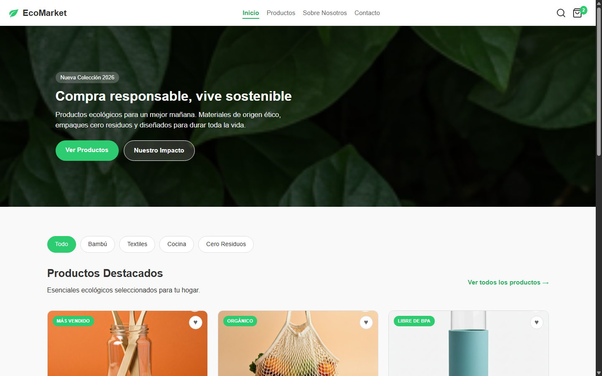
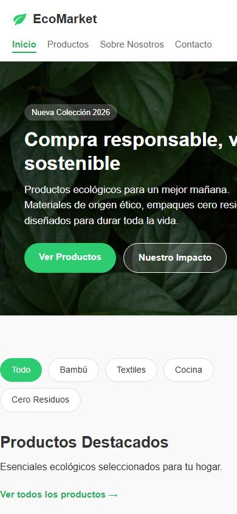
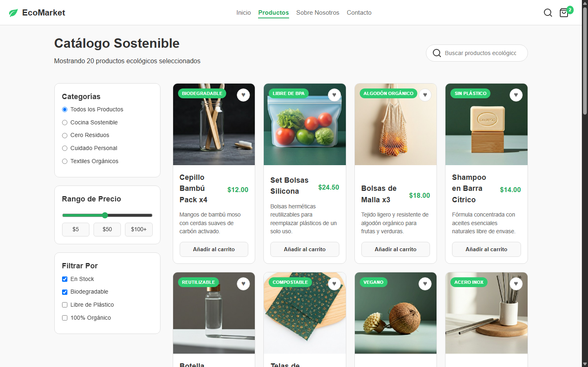
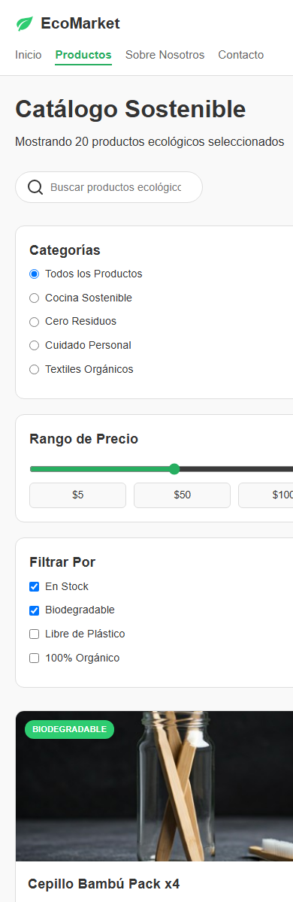
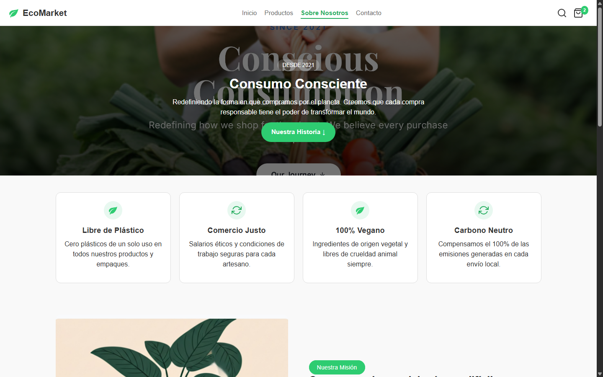
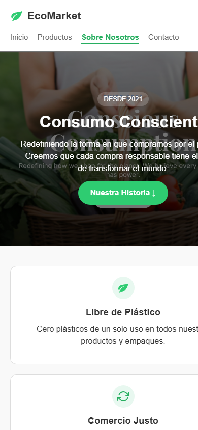
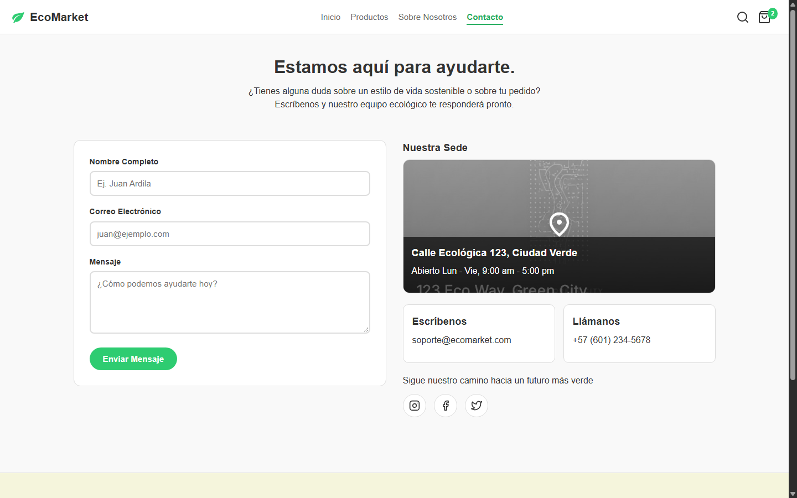
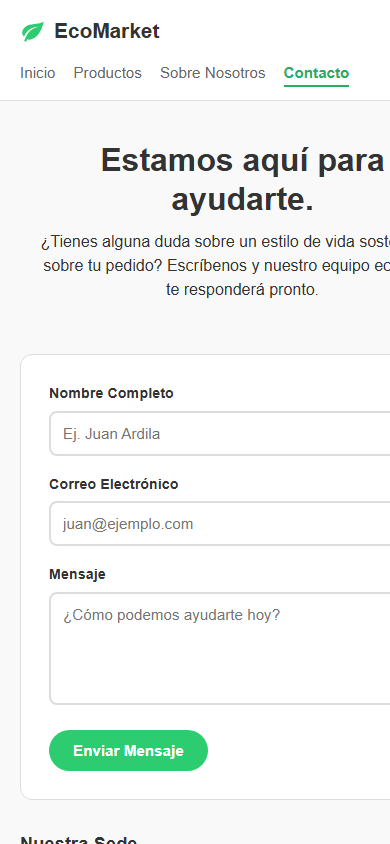

# EcoMarket - Tienda Ecológica

Maquetación web responsiva para **EcoMarket**, una tienda en línea de productos ecológicos, reutilizables y de consumo consciente, desarrollada únicamente con HTML5 semántico y CSS3 puro.

## Enlace de la Página (Demo en Vivo)

- **Sitio desplegado**: [https://ecomarket-juanardila.netlify.app/](https://ecomarket-juanardila.netlify.app/)

## Descripción del Proyecto

El sitio cuenta con 4 vistas principales interconectadas que permiten explorar productos sostenibles, filtrar el catálogo por categorías o rango de precio, conocer la historia y misión ecológica de la marca y enviar consultas mediante un formulario con validación nativa.

## Tecnologías Utilizadas

- **HTML5 Semántico**: Uso estructurado de `<header>`, `<nav>`, `<main>`, `<section>`, `<article>`, `<aside>` y `<footer>`.
- **CSS3 Puro (Sin JavaScript)**:
  - Variables CSS (`:root`) para la paleta de colores.
  - Diseño **Mobile First** con CSS Grid y Flexbox (`768px` para tablet y `1024px` para desktop).
  - Barra lateral de filtros fija con `position: sticky`.
  - Animaciones e interacciones con `:hover`, `:active`, `:target` y validación de formularios con `:valid` e `:invalid`.

## Estructura de Carpetas

```text
EcoMarket_JuanArdila/
├── index.html
├── README.md
├── css/
│   ├── main.css
│   ├── layout.css
│   ├── components.css
│   └── animations.css
├── img/
│   ├── evidencia/
│   │   ├── pc-inicio.png
│   │   ├── telefono-inicio.png
│   │   ├── pc-productos.png
│   │   ├── telefono-productos.png
│   │   ├── pc-sobre-nosotros.png
│   │   ├── telefono-sobre-nosotros.png
│   │   ├── pc-contacto.png
│   │   └── telefono-contacto.png
│   ├── hero/
│   ├── icons/
│   └── products/
└── views/
    ├── productos.html
    ├── sobre-nosotros.html
    └── contacto.html
```

## Vistas del Proyecto

1. **Inicio (`index.html`)**: Cabecera de navegación, banner principal (Hero), filtros rápidos, grilla responsiva de 6 productos destacados y suscripción al boletín.
2. **Catálogo (`views/productos.html`)**: Buscador superior, barra lateral (`sticky`) de filtros de categorías y precios, grilla adaptable de 20 productos con selección de favoritos y paginación visual.
3. **Sobre Nosotros (`views/sobre-nosotros.html`)**: Principios ecológicos, sección de historia alineada con Flexbox y carrusel horizontal de testimonios.
4. **Contacto (`views/contacto.html`)**: Formulario de soporte con bordes de validación en tiempo real (`:valid` / `:invalid`), mapa estático de sede e íconos de redes sociales animados.

## Evidencia (Capturas de Pantalla en Google Chrome)

A continuación se presenta la evidencia visual del comportamiento y diseño responsivo (*Mobile First*) del sitio web en **Google Chrome**, contrastando la visión de escritorio (PC) y la visión móvil (Teléfono) para cada una de las 4 vistas del proyecto:

### 1. Vista de Inicio (`index.html`)

| Visión de PC (Escritorio - Chrome) | Visión de Teléfono (Móvil - Chrome) |
| :--- | :--- |
|  |  |

---

### 2. Vista del Catálogo de Productos (`views/productos.html`)

| Visión de PC (Escritorio - Chrome) | Visión de Teléfono (Móvil - Chrome) |
| :--- | :--- |
|  |  |

---

### 3. Vista Sobre Nosotros (`views/sobre-nosotros.html`)

| Visión de PC (Escritorio - Chrome) | Visión de Teléfono (Móvil - Chrome) |
| :--- | :--- |
|  |  |

---

### 4. Vista de Contacto (`views/contacto.html`)

| Visión de PC (Escritorio - Chrome) | Visión de Teléfono (Móvil - Chrome) |
| :--- | :--- |
|  |  |

## Cómo Ejecutar el Proyecto Localmente

1. Clona este repositorio en tu máquina local:
   ```bash
   git clone <https://github.com/JuanJArdilaA/EcoMarket_JuanArdila.git>
   ```
2. Abre la carpeta del proyecto en tu editor de código (como VS Code).
3. Abre el archivo `index.html` directamente en tu navegador web o utilizando la extensión **Live Server**.
